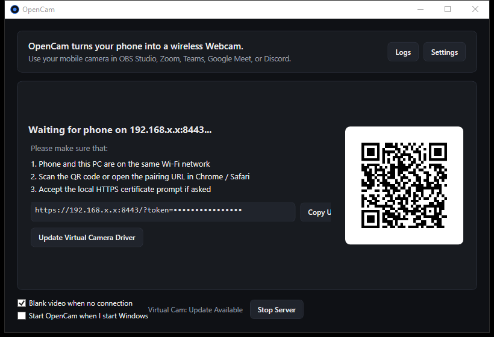
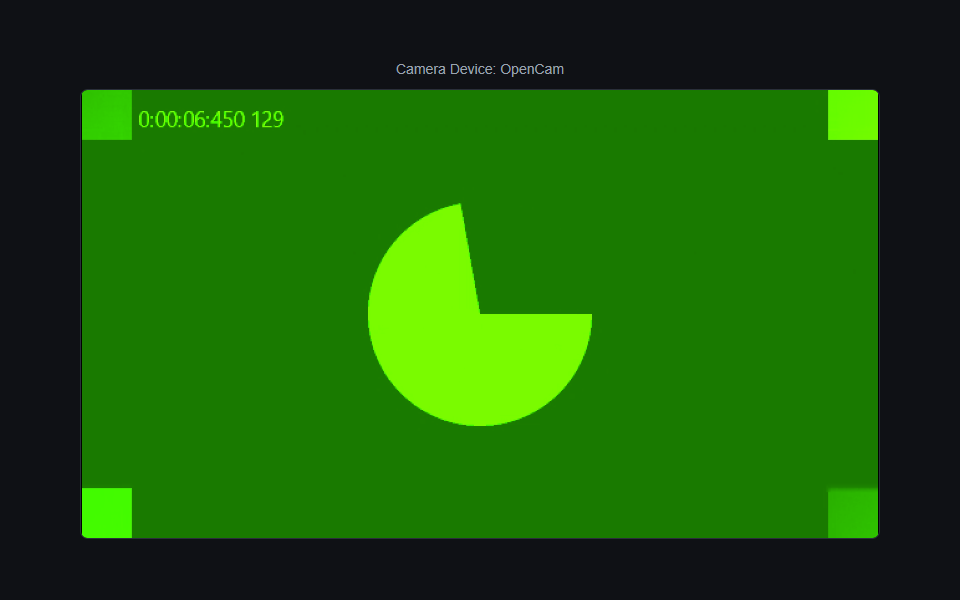

# OpenCam — Universal Wireless Webcam System

Turn Android phones, iPhones, iPads, and any camera-enabled browser into a low-latency wireless webcam for Windows PCs over local Wi-Fi — with **no mobile app installation**, **no cloud dependency**, **QR code pairing**, **multi-phone hot-switching**, and a **native x64 Windows DirectShow Virtual Webcam (`OpenCam`)** compatible with OBS Studio, Zoom, Microsoft Teams, Google Meet, Chrome, and Discord.

---

## Screenshots

### Desktop App (QR Pairing & Waiting Screen)


### Mobile Web Viewfinder (Icon-Friendly Full-Screen Camera)


### Windows Virtual Webcam (`OpenCam` in Chrome / OBS / Meet)


---

## Features

- **Browser-First Mobile Capture:** Works directly in Chrome (Android) and Safari (iPhone/iPad) — no APK or App Store install required.
- **True WebRTC Low-Latency Streaming:** Real-time VP8 video and Opus/PCMU audio over DTLS/SRTP with STUN/TURN fallback and automatic reconnection.
- **Native Windows Virtual Webcam (`OpenCam`):** Embedded x64 DirectShow COM filter (`OpenCamVirtualCam.dll`) that appears as **`OpenCam`** in OBS Studio, Zoom, Microsoft Teams, Google Meet, Discord, and Chrome.
  - Displays an animated `"PLEASE CONNECT OPENCAM"` TV-glitch standby screen by default and automatically switches back within 1.5s if the phone stops streaming (or outputs blank video if configured).
- **Multi-Phone Connections & Hot-Switching:** Connect 2–3 phones simultaneously and switch which camera feeds the active `OpenCam` virtual webcam in real time.
- **Icon-Friendly Mobile Controls:** Full-screen `100dvh × 100vw` viewfinder with Flip Camera, Auto-Mirror (`A` / `1` / `0`), Torch, Microphone toggle, Fit/Fill, Fullscreen, Wake Lock, and dynamic capability detection.
- **LAN-First Privacy & Security:** Local self-signed HTTPS/WSS (`Kestrel`), QR code pairing with cryptographically random session tokens, optional PIN protection, device revocation, and automatic Windows Firewall port management on startup/exit.
- **Single-File Standalone Executable:** Self-contained `win-x64` `OpenCam.exe` with embedded React+TS mobile UI, native DirectShow driver, SQLite persistence, and System Tray integration.

---

## Quick Start (Download & Run)

1. Download **`OpenCam.exe`** from the [Releases](https://github.com/razeltech/opencam/releases) page.
2. Run **`OpenCam.exe`** on your Windows PC and accept the Windows Firewall UAC prompt (automatically opens the local HTTPS/WebRTC port while running and cleans it up on exit).
3. Click **Register Virtual Camera** once (accept UAC) to install `OpenCamVirtualCam.dll` into `C:\Program Files\OpenCam\`.
4. Scan the **QR code** with your phone or iPad on the same Wi-Fi network, accept the local HTTPS certificate prompt, and tap **Allow Camera & Connect**.
5. Select **`OpenCam`** as your camera in **OBS Studio, Zoom, Microsoft Teams, Google Meet, or Discord**.

---

## Architecture

| Project | Responsibility |
|---|---|
| `OpenCam.Core` | Domain models, thread-safe secret-redacting rolling logger, LAN IPv4 & port discovery |
| `OpenCam.Storage` | SQLite (`Microsoft.Data.Sqlite`) persistence for settings, paired devices, and audit events |
| `OpenCam.Security` | Self-signed LAN HTTPS certificate generator, pairing tokens/PIN, QR PNG generator, Windows Firewall helper |
| `OpenCam.WebRTC` | `SIPSorcery` WebRTC peer manager, early ICE candidate queuing, VP8/Opus decoding, stride alignment |
| `OpenCam.Server` | Embedded ASP.NET Core Kestrel HTTPS + WebSocket signaling server + embedded mobile web UI |
| `OpenCam.VirtualCamera` | Shared-memory BGR24 frame pipeline & elevated `regsvr32` driver manager |
| `OpenCam.VirtualCamera.Native` | Native x64 C++ DirectShow Virtual Camera COM DLL (`OpenCamVirtualCam.dll`) |
| `OpenCam.Desktop` | WPF desktop dashboard (`Studio Pro Dark` / `Light` theme), live preview, System Tray, Logs & Audit |
| `src/mobile-web` | React + TypeScript full-screen mobile camera web application |
| `OpenCam.Tests` | xUnit automated unit & integration test suite |

---

## Build from Source

### Prerequisites
- [.NET 9 SDK](https://dotnet.microsoft.com/download/dotnet/9.0)
- Node.js 20+ (for building `src/mobile-web`)
- Visual Studio 2022 C++ Build Tools (only if recompiling `OpenCamVirtualCam.dll`)

### Commands
```powershell
# 1. Build mobile web UI
cd src/mobile-web
npm install
npm run build
cd ../..

# 2. Build & run tests
dotnet build
dotnet test --no-build

# 3. Publish single-file win-x64 executable
dotnet publish src/OpenCam.Desktop/OpenCam.Desktop.csproj -c Release -r win-x64 --self-contained true `
  -p:PublishSingleFile=true -p:IncludeNativeLibrariesForSelfExtract=true `
  -p:IncludeAllContentForSelfExtract=true -p:EnableCompressionInSingleFile=true `
  -p:DebugType=none -p:DebugSymbols=false -o publish/OpenCam
```
